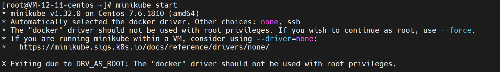

官方文档：

- [minikube start | minikube](https://minikube.sigs.k8s.io/docs/start/)


## 下载安装 minikube

To install the latest minikube **stable** release on **x86-64** **Linux** using **binary download**:

```shell
curl -LO https://storage.googleapis.com/minikube/releases/latest/minikube-linux-amd64
sudo install minikube-linux-amd64 /usr/local/bin/minikube && rm minikube-linux-amd64
```

## 启动 minikube

```shell
minikube start
```



minikube和docker 冲突问题，可通过如下命令启动

```shell
 minikube start --force --driver=docker
```


