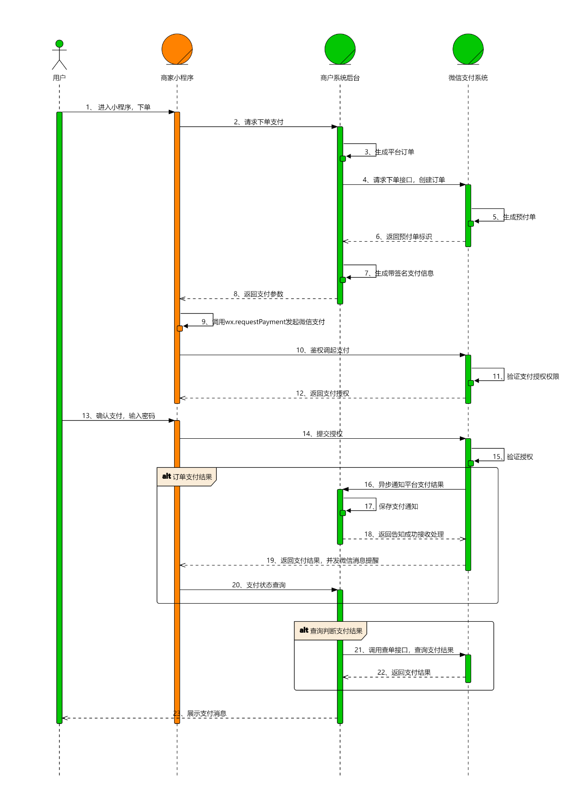

## 结算支付


### 01. 配置分包并跳转到结算页面


**思路分析：**


随着项目功能的增加，项目体积也随着增大，从而影响小程序的加载速度，影响用户的体验。

因此我们需要将 `结算支付` 功能配置成一个分包，

当用户在访问设置页面时，还预先加载 `结算支付` 所在的分包


**落地代码：**


`➡️ app.json`

```json
"subPackages": [
  {
    "root": "modules/settingModule",
    "name": "settingModule",
    "pages": [
      "pages/address/add/index",
      "pages/address/list/index",
      "pages/profile/profile"
    ]
  },
  {
    "root": "modules/goodModule",
    "name": "goodModule",
    "pages": ["pages/goods/list/list", "pages/goods/detail/detail"]
  },
+   {
+     "root": "modules/orderPayModule",
+     "name": "orderPayModule",
+     "pages": [
+       "pages/order/detail/detail",
+       "pages/order/list/list"
+     ]
+   }
],
"preloadRule": {
  "pages/settings/settings": {
    "network": "all",
    "packages": ["settingModule"]
  },
  "pages/category/category": {
    "network": "all",
    "packages": ["goodModule"]
  },
+   "pages/cart/cart": {
+     "network": "all",
+     "packages": ["orderPayModule"]
+   }
}

```


`➡️ pages/cart/cart.js`

```js
// 跳转到订单结算页面
toOrder() {
  if (this.data.totalPrice === 0) {
    wx.toast({
      title: '请选择需要购买的商品'
    })

    return
  }

  // 跳转到订单的结算页面
  wx.navigateTo({
    url: '/modules/orderPayModule/pages/order/detail/detail'
  })
}
```


`➡️ pages/cart/cart.wxml`

```html
<van-submit-bar
  wx:if="{{ cartList.length }}"
  price="{{ totalPrice * 100 }}"
  button-text="去结算"
  tip="{{ true }}"
+  bindsubmit="toOrder"
>
  <van-checkbox
    value="{{ selectAllStatus }}"
    checked-color="#FA4126"
    bindchange="selectAllStatus"
  >
    全选
  </van-checkbox>
</van-submit-bar>
```


### 02. 封装结算支付的接口 API


**思路分析：**


为了方便后续进行结算支付模块的开发，我们在这一节将结算支付所有的接口封装成接口 API 函数


**落地代码：**


`➡️ /api/orderpay.js`

```js
import http from '@/utils/http'

/**
 * @description 获取订单详情
 * @returns Promise
 */
export const reqOrderInfo = () => {
  return http.get('/order/trade')
}

/**
 * @description 获取订单列表
 * @param {*} page 页码
 * @param {*} limit 每页展示的条数
 * @returns Promise
 */
export const reqOrderList = (page, limit) => {
  return http.get(`/order/order/${page}/${limit}`)
}

/**
 * @description 获取订单收货地址
 * @returns Promise
 */
export const reqOrderAddress = () => {
  return http.get('/userAddress/getOrderAddress')
}

/**
 * @description 获取立即购买商品的详情信息
 * @param { Object } params { goodsId: 商品 Id,  blessing：祝福语 }
 * @returns Promise
 */
export const reqBuyNowGoods = ({ goodsId, ...data }) => {
  return http.get(`/order/buy/${goodsId}`, data)
}

/**
 * @description 提交订单
 * @returns Promise
 */
export const reqSubmitOrder = () => {
  return http.post('/order/submitOrder')
}

/**
 * @description 获取微信预支付信息
 * @param {*} orderNo 订单 ID
 * @returns Promise
 */
export const reqPreBuyInfo = (orderNo) => {
  return http.get(`/webChat/createJsapi/${orderNo}`)
}

/**
 * @description 微信支付状态查询
 * @param {*} orderNo
 * @returns Promise
 */
export const reqPayStatus = (orderNo) => {
  return http.get(`/webChat/queryPayStatus/${orderNo}`)
}

```


### 03. 商品结算-获取收货地址


**思路分析：**


进入结算支付页面后，需要获取收货地址信息，在获取到收货地址以后，需要进行判断，

如果没有获取到收货地址，需要展示添加收货地址的结构，

如果获取到了收货地址，需要渲染收货地址。


**实现步骤：**


1. 在进入结算页面的时候，调用接口 `API` 函数，获取数据
2. 然后根据数据并渲染结构


**落地代码：**


`➡️ /pages/order/detail/index.js`

```js
import { getTradeAddress } from '../../../api/order'

Page({
    
  data: {
    // coding...
+     orderAddress: {} // 收货地址
  },

+   // 获取收货地址
+   async getAddress() {
+     const { data: orderAddress } = await reqOrderAddress()
+ 
+     this.setData({
+       orderAddress
+     })
+   },

+   // 页面展示时触发的钩子函数
+   onShow() {
+     this.getAddress()
+   }
})
```


`➡️ /pages/order/detail/index.wxml`

```html
<!--pages/order/index.wxml-->
<view class="container order">
  <view class="address-card">
    <!-- 添加收货地址 -->
    <view wx:if="{{ !tradeAddress.id }}" class="add-address"  bindtap="toAddress">
      <van-icon size="22px" name="add" />
      <view>添加收货地址</view>
    </view>

    <view wx:else class="order-address flex">
      <view class="address-content">
        <view class="title">{{ tradeAddress.fullAddress }}</view>
        <view class="info flex">
          <text>{{ tradeAddress.name }}</text>
          <text>{{ tradeAddress.phone }}</text>
        </view>
      </view>

      <view class="select-address">
        <navigator class="navigator" url="/modules/settingModule/pages/address/list/index">
          <van-icon color="#bbb" name="arrow" size="22px" />
        </navigator>
      </view>
    </view>

    <view class="top-line"></view>
  </view>

  <view class="order-info">
    <!-- coding... -->
  </view>

</view>
```


### 04. 商品结算-更新收货地址功能


**思路分析：**


当用户需要更改收货地址时，我们需要跳转到收货地址页面，重新选择收货地址

当用户点击了某个地址以后，我们需要将该地址显示到商品结算页面中。


更新收货地址功能，采用 `getApp()` 全局共享数据的方式来实现。


**实现步骤：**


4. 在 `app.js` 中定义全局共享的数据 `globalData.address`
2. 点击箭头，携带参数跳转到收货地址页面，标识是从订单结算页面进入
3. 在选择收货地址成功以后，将数据存储到 `globalData.address`中，然后返回到订单结算页面。
4. 在订单结算页面判断 `globalData.address` 是否存在收货地址数据，如果存在则渲染


**落地代码：**


`➡️ app.js`

```js
App({
    
+   // 定义全局共享的数据
+   globalData: {
+    address: {}
+  }
    
  // coding...
})
```


`➡️ /pages/address/list/index.html`

```html
<!-- 每一个收货地址 -->

<view
  class="info"
+   bindtap="changeAddress"
+   data-id="{{ item.id }}"
>
  <view class="user-info">
    <text>{{ item.name }}</text>
    <text>{{ item.phone }}</text>
    <text wx:if="{{ item.isDefault === 1 }}" class="default-tag">默认</text>
  </view>

  <view class="address-info"> {{ item.fullAddress }} </view>
</view>
```


`➡️ /pages/address/list/index.js`

```js
// 导入接口 API 函数
import { reqAddressList, reqDelAddress } from '@/api/address'
import { swipeCellBehavior } from '@/behaviors/swipeCell'

+ // 获取全局的应用实例
+ const app = getApp()

Page({

  // coding...

+   // 切换收货地址
+   changeAddress(event) {
+     // 判断是否是从订单结算页面进入
+     if (this.flag !== '1') return
+ 
+     // 获取到点击的收货地址 id
+     const addressId = event.currentTarget.dataset.id
+     // 从收货地址列表中获取到获取到点击的收货地址详细信息
+     const address = this.data.addressList.find((item) => item.id === addressId)
+ 
+     // 如果获取成功，将数据存储到 globalData 中
+     if (address) {
+       app.globalData.address = address
+       wx.navigateBack()
+     }
+   },

+   onLoad(options) {
+     this.flag = options.flag
+   }
})

```


`➡️ /pages/order/detail/index.wxml`

```html
<view class="select-address">
  <navigator
    class="navigator"
+     url="/modules/settingModule/pages/address/list/index?flag=1"
  >
    <van-icon color="#bbb" name="arrow" size="22px" />
  </navigator>
</view>
```


`➡️ /pages/order/detail/index.js`

```js
  // 获取订单页面的收货地址
  async getAddress() {
      
+     // 如果 globalData 存在收货地址，取出收货地址
+     if (app.globalData.address.id) {
+       this.setData({
+         orderAddress: app.globalData.address
+       })
+ 
+       // 在赋值以后需要将收货地址清空
+       app.globalData.address = {}
+ 
+       return
+     }

    // 如果 globalData 中不存在收货地址，获取收货地址渲染即可
    const { data: orderAddress } = await reqOrderAddress()

    this.setData({
      orderAddress
    })
  },
```


### 05. 商品结算-获取订单详情数据


**思路分析：**


商品结算页面数据获取收货地址以及商品订单信息


**实现步骤：**


2. 导入封装的接口 `API` 函数
4. 在进入结算页面的时候，调用接口 `API` 函数，获取数据，然后根据数据并渲染结构即可


**落地代码：**


`➡️ /pages/order/detail/index.js`

```js
+ import { reqOrderAddress, reqOrderInfo } from '@/api/orderpay'

Page({
    
  data: {
    // coding...
    orderAddress: {}, // 收货地址
+     orderInfo: {}, // 订单商品详情
  },
     
+   // 获取订单详情
+   async getOrderInfo() {
+     const { data: orderInfo } = await reqOrderInfo()
+ 
+     // 判断是否存在祝福语
+     // 如果需要购买多个商品，挑选第一个填写了祝福语的商品进行赋值
+     const orderGoods = orderInfo.cartVoList.find((item) => item.blessing !== '')
+ 
+     this.setData({
+       orderInfo,
+       blessing: orderGoods && orderGoods.blessing
+     })
+   },

  // 在页面展示的时候进行触发
  onShow() {
    // 获取收货地址
    this.getAddress()

+     // 获取订单结算页面的商品信息
+     this.getOrderInfo()
  },
})
```


`➡️ /pages/order/detail/index.wxml`

```html
<!--pages/order/index.wxml-->
<view class="container order">
  <view class="address-card">
    <!-- 添加收货地址 -->
    <!-- coding... -->
  </view>

  <view class="goods-wraper">
    <!-- 商品清单 -->
    <view class="goods-list">

+       <view class="goods-item flex" wx:for="{{ tradeInfo.cartVoList }}" wx:key="goodsId">
        <view class="img">
+           <image src="{{ item.imageUrl }}" />
        </view>
        <view class="content">
+           <view class="goods-title">{{ item.name }}</view>
          <view class="goods-price">
+             <view class="price"> ¥ {{ item.price }}</view>
+             <view>x {{ item.count }}</view>
          </view>
        </view>
      </view>
    </view>
  </view>

  <view class="payment">
    <!-- 支付方式 -->
    <view class="time-wraper flex">
      <image src="/static/images/payment_wxzf.png" />
      <view class="title">支付方式</view>
      <van-checkbox value="{{true}}"></van-checkbox>
    </view>
  </view>

  <!-- 支付区域 -->
  <view class="footer flex">
+     <view class="left"> ¥ {{ tradeInfo.totalAmount }} </view>
    <viwe class="right">结算</viwe>
  </view>

  <!-- 日期选择弹框 -->
  <van-popup show="{{ show }}" round position="bottom" custom-style="height: 50%" bind:close="onClose">
    <van-datetime-picker type="date" min-date="{{ minDate }}" model:value="{{ currentDate }}" bind:confirm="onConfirmTimerPicker" bind:cancel="onCancelTimePicker" />
  </van-popup>

</view>
```


### 06. 商品结算-获取立即购买数据


**思路分析：**


当用户从商品详情点击立即购买进入商品结算页面的时候，我们需要在商品结算页面展示立即购买商品的基本信息。


在跳转到商品结算页面的时候，我们已经携带了商品的 `id` 和 `祝福语`。

在结算页面，只需要获取到传递的参数，然后根据传递的参数调用接口即可。


**实现步骤：**


2. 在页面打开的时候，`onShow` 中接受传递的参数，并赋值给 `data` 中的状态
3. 在 `getOrderInfo` 函数中，判断立即购买商品的 `id` 是否存在，如果存在调用立即购买的接口
4. 获取数据后，然后根据数据并渲染结构即可


**落地代码：**


`➡️ /pages/order/detail/index.js`

```js
import {
  reqOrderAddress,
  reqOrderInfo,
+   reqBuyNowGoods
} from '@/api/orderpay'

Page({

    
  // 获取订单详情
  async getOrderInfo() {
+ 	  // 从 data 中结构数据      
+     const { goodsId, blessing } = this.data

+	 // 判断是否存在商品 id，
     // 如果存在调用立即购买商品详情的接口
     // 不存在调用获取订单详情数据接口
+    const { data: orderInfo } = goodsId
      ? await reqBuyNowGoods({ goodsId, blessing })
      : await reqOrderInfo()

    // 判断是否存在祝福语
    // 如果需要购买多个商品，挑选第一个填写了祝福语的商品进行赋值
    const orderGoods = orderInfo.cartVoList.find((item) => item.blessing !== '')
      
    this.setData({
      orderInfo,
      orderGoods && orderGoods.blessing
    })
  }
    
 +  // 接收立即购买传递的参数
 +  onLoad (options) {
 +    this.setData({
 +       ...options
 +    })
 +  },

  // 在页面展示的时候进行触发
  onShow() {
    // 获取收货地址
    this.getAddress()

    // 获取订单结算页面的商品信息
    this.getOrderInfo()
  }
})

```


### 07. 商品结算-收集送达时间


**思路分析：**


当选择送达日期的时候，需要选择收货的时间，我们希望获取到的收货的时间格式是：年月日

但是我们使用的是小程序提供的 `vant` 组件，组件返回的时候并不是真正的时分秒，而是时间戳


这时候可以调用小程序项目初始化时，小程序封装的时间格式化工具


**实现步骤：**


1. 在商品结算页面导入封装好的格式化时间的方法 `formatTime`
2. 调用  `formatTime` ，传入需要格式化的时间戳


**落地代码：**


`➡️ /pages/order/detail/index.js`

```js
import { formatTime } from '../../../utils/formatTime.js'

Page({
  
  // coding...

  // 期望送达日期确定按钮
  onConfirmTimerPicker(event) {
    // 使用 new Date 将时间戳转换成 JS 中的日期对象
    const time = formatTime(new Date(event.detail))
    
    // 将转换以后的时间赋值给送到时间
    this.setData({
      show: false,
      deliveryDate: time
    })
  }
 
  // coding...
}
```


### 08. 商品结算-表单数据验证


**思路分析：**


使用 `async-validator` 对代码进行验证


1. 收货地址不能为空
2. 订购人姓名不能为空，且不能输入特殊字符
3. 订购人手机号不能为空，且输入的手机号必须合法
4. 送达日期不能为空


**落地代码：**


```js
import { reqOrderAddress, reqOrderInfo, reqBuyNowGoods } from '@/api/orderpay'
// 导入 async-validator 对参数进行验证
import Schema from 'async-validator'
// 导入格式化时间的方法
import { formatTime } from '@/utils/formatTime'

// 获取应用实例
const app = getApp()

Page({
  data: {
    buyName: '', // 订购人姓名
    buyPhone: '', // 订购人手机号
    deliveryDate: '', // 期望送达日期
    blessing: '', // 祝福语
    show: false, // 期望送达日期弹框
    orderAddress: {}, // 收货地址
    orderInfo: {}, // 订单商品详情
    minDate: new Date().getTime(),
    currentDate: new Date().getTime()
  },

  async submitOrder() {
    // 从 data 中结构数据
    const {
      buyName,
      buyPhone,
      deliveryDate,
      blessing,
      orderInfo,
      orderAddress
    } = this.data

    // 组织请求参数
    const params = {
      buyName,
      buyPhone,
      deliveryDate,
      remarks: blessing,
      cartList: orderInfo.cartVoList,
      userAddressId: orderAddress.id
    }

    // 对请求参数进项验证
    const { valid } = await this.validatorPerson(params)

    // 打印验证结果
    console.log(valid)
  },

  // 对新增收货地址请求参数进行验证
  validatorPerson(params) {
    // 验证收货人，是否只包含大小写字母、数字和中文字符
    const nameRegExp = '^[a-zA-Z\\d\\u4e00-\\u9fa5]+$'

    // 验证手机号，是否符合中国大陆手机号码的格式
    const phoneReg = '^1(?:3\\d|4[4-9]|5[0-35-9]|6[67]|7[0-8]|8\\d|9\\d)\\d{8}$'

    // 创建验证规则
    const rules = {
      userAddressId: [{ required: true, message: '请选择收货地址' }],
      buyName: [
        { required: true, message: '请输入收货人姓名' },
        { pattern: nameRegExp, message: '收货人姓名不合法' }
      ],
      buyPhone: [
        { required: true, message: '请输入收货人手机号' },
        { pattern: phoneReg, message: '收货人手机号不合法' }
      ],
      deliveryDate: { required: true, message: '请选择送达时间' }
    }

    // 传入验证规则进行实例化
    const validator = new Schema(rules)

    // 调用实例方法对请求参数进行验证
    // 注意：我们希望将验证结果通过 Promise 的形式返回给函数的调用者
    return new Promise((resolve) => {
      validator.validate(params, (errors) => {
        if (errors) {
          // 如果验证失败，需要给用户进行提示
          wx.toast({ title: errors[0].message })
          // 如果属性值是 false，说明验证失败
          resolve({ valid: false })
        } else {
          // 如果属性值是 true，说明验证成功
          resolve({ valid: true })
        }
      })
    })
  },
    
  
  // coding....
})
```


### 09. 小程序支付-小程序支付流程


**小程序支付图示：**





**前端需要做的事情：**


1. `生成平台订单`：前端调用接口，向后端传递需要购买的商品信息、收货人信息，[后端生成平台订单，返回订单编号]

2. `获取预付单信息`：将订单编号发送给后端后， [后端向微信服务器获取预付单信息，后端会将微信服务器返回的预付单信息进行加密，然后将加密以后的预付单信息返回给前端]

3. `发起微信支付`：前端调用 wx.requestPayment() 发起微信支付

4. `查询支付状态`：调用接口查询支付状态


### 10. 小程序支付-创建平台订单


**思路分析：**


用户在完成选购流程，确认商品信息、订购人、收货人等信息无误后，

用户需要点击提交订单按钮，开始进行下单支付，这时候需要先创建平台订单。


**实现步骤：**


1. 在提交订单的事件处理函数中调用封装的接口 API 函数
2. 在接口调用成功以后，将服务器响应的订单编码挂载到页面实例上。


**落地代码：**


`➡️ /pages/order/detail/index.js`

```js
import {
  reqOrderAddress,
  reqOrderInfo,
  reqBuyNowGoods,
+   reqSubmitOrder
} from '@/api/orderpay'

Page({
   
  // coding...
    
  // 提交订单
    // 处理提交订单
  async submitOrder() {
    // 需要从 data 中解构数据
    const {
      buyName,
      buyPhone,
      deliveryDate,
      blessing,
      orderAddress,
      orderInfo
    } = this.data

    // 需要根据接口要求组织请求参数
    const params = {
      buyName,
      buyPhone,
      cartList: orderInfo.cartVoList,
      deliveryDate,
      remarks: blessing,
      userAddressId: orderAddress.id
    }

    // 对请求参数进行验证
    const { valid } = await this.validatorPerson(params)

+     // 如果验证失败，直接 return，不执行后续的逻辑处理
+     if (!valid) return
+ 
+     // 调用接口，创建平台订单
+     const res = await reqSubmitOrder(params)
+ 
+     // 在平台订单创建成功以后，将订单编号挂载到页面实例上
+     if (res.code === 200) {
+       // 将订单编号挂载到页面实例上
+       this.orderNo = res.data
+     }
  }
    
    
  // coding...
})
```


### 11. 小程序支付-获取预付单信息


**思路分析：**


将订单编号发送给公司的后端，公司的后端会从数据库找到对应订单的信息。

然后调用微信服务器的 下单接口 进行创建订单，订单创建成功以后，微信服务器会给公司后端返回预付单信息。

公司后端对返回的预付单信息进行加密，返回给小程序客户端。


这一步，咱们需要做的就是：订单编号发送给公司的后端，其他逻辑时后端来完成的。


> 📌：注意事项：
>
> ​	小程序支付后面的代码，大伙在实现的时候，会出现异常。
>
> ​	这是因为没有小程序的开发权限，以后在实际开发中，只需要参考当前流程进行开发即可


**落地代码：**


`➡️ /pages/order/detail/index.js`

```js
Page({
    // 处理提交订单
  async submitOrder() {
    // 需要从 data 中解构数据
    const {
      buyName,
      buyPhone,
      deliveryDate,
      blessing,
      orderAddress,
      orderInfo
    } = this.data

    // 需要根据接口要求组织请求参数
    const params = {
      buyName,
      buyPhone,
      cartList: orderInfo.cartVoList,
      deliveryDate,
      remarks: blessing,
      userAddressId: orderAddress.id
    }

    // 对请求参数进行验证
    const { valid } = await this.validatorPerson(params)

    // 如果请求参数验证失败，直接 return ，不执行后续的逻辑
    if (!valid) return

    // 调用接口，创建平台订单
    const res = await reqSubmitOrder(params)

    if (res.code === 200) {
      // 在平台订单创建成功以后，需要将服务器、后端返回的订单编号挂载到页面实例上
      this.orderNo = res.data
      
+       // 获取预付单信息、支付参数
+       this.advancePay()
    }
  },

+   // 获取预付单信息、支付参数
+   async advancePay() {
+     // 调用接口，获取预付单信息、支付参数
+     const payParams = await reqPrePayInfo(this.orderNo)
+ 
+     if (payParams.code === 200) {
+       console.log(res.data)
+     }
+   },

})
```


### 12. 小程序支付-发起微信支付


**知识点：**


小程序客户端在接收支付参数后，调用 `wx.requestPayment()` 发起微信支付，

唤醒支付弹窗，用户开输入支付密码或者进行指纹等操作，微信服务器会进行验证，如果验证成功，就会发起支付。

然后会将支付结果返回给公司后端，也会返回给 `wx.requestPayment()` 

并且会微信通知用户支付结果


**落地代码：**


`➡️ /pages/order/detail/index.js`

```js
// 获取预付单信息、支付参数
async advancePay() {
 try {
    const payParams = await reqPrePayInfo(this.orderNo)

    if (payParams.code === 200) {
      // 进行微信支付
      const payInfo = await wx.requestPayment(payParams.data)
      
      console.log(payInfo)
    }
  } 
  catch {
    wx.toast({ title: '支付遇到问题，请联系客服', icon: 'error' })
  }
}

```


### 13. 小程序支付-支付状态查询


**思路分析：**


通过调用后端接口获取支付状态，如果支付成功，需要给用户提示，同时跳转到订单列表页面。


公司后端开始向微信服务器发送请求，查询支付结果

公司服务器会将微信服务器返回的支付结果，返回到客户端

客户端根据查询结果跳转到订单列表页面


**落地代码：**

`➡️ /pages/order/detail/index.js`

```js
// 获取预付单信息、支付参数
async advancePay() {
  try {
    const payParams = await reqPrePayInfo(this.orderNo)

    if (payParams.code === 200) {
      // payParams.data 就是获取的支付参数

      // 调用  wx.requestPayment 发起微信支付
      const payInfo = await wx.requestPayment(payParams.data)
      
      // 获取支付结果
      if (payInfo.errMsg === 'requestPayment:ok') {
        // 查询订单的支付状态
        const payStatus = await reqPayStatus(this.orderNo)

        if (payStatus.code === 200) {
          wx.redirectTo({
            url: '/pages/order/list/index',
            success: () => {
              wx.toast({
                title: '支付成功',
                icon: 'success
              })
            }
          })
        }
      }
      
    }
  } catch (error) {
    wx.toast({
      title: '支付失败，请联系客服',
      icon: 'error'
    })
  }
},
```


